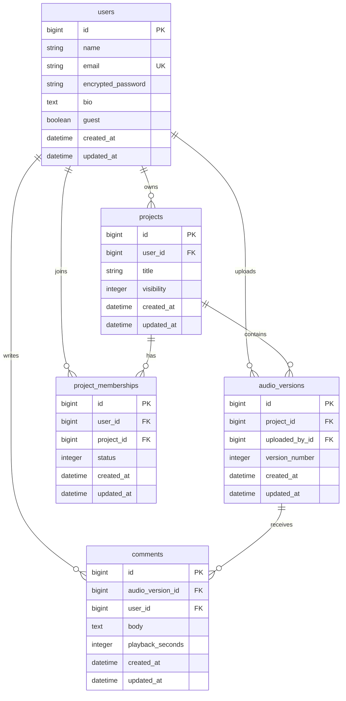

# 🎵 DemoComm

DemoCommは、音楽制作におけるデモ音源の共有・バージョン管理・フィードバックを一元化するWebアプリケーションです。

## 📖 概要

DemoCommは、バンドや音楽制作チームが、楽曲制作の過程で発生する音源ファイルの確認とそのフィードバックを効率的に管理するために開発したWebアプリケーションです。

楽曲ごとにプロジェクトを作成し、複数の音源バージョンを保存できます。

各バージョンに対するコメント機能やメンバー招待機能を備え、音楽制作における情報共有とコミュニケーションを可能にし、制作を効率化させます。

### なぜ作ったのか

私は約5年間のバンド活動を通じて、デモ音源の制作や楽曲制作においてメンバーやエンジニアと意見交換を経験してきました。
その中で以下の課題を感じていました。

- **音源管理の煩雑さ**：修正を重ねるたびに音源ファイルが増え、バージョンの整理が難しくなる
- **フィードバックの分散**：LINEなどで意見を交換すると、どの音源に対するコメントなのか分かりにくくなる
- **情報共有の非効率さ**：音源ファイルと修正内容を別々に管理する必要がある

これらの課題を解決するため、音源のバージョン管理とコメント機能を組み合わせたDemoCommを開発しました。
また、Ruby on Railsを用いたWebアプリケーション開発を実践的に学ぶことも目的としています。

## ✨ 主な機能

- **ユーザー認証**：新規登録・ログイン・ログアウト・プロフィール管理
- **ゲストログイン**：アカウント登録不要でアプリの機能を体験
- **プロジェクト管理**：楽曲ごとのプロジェクト作成・編集・削除
- **公開範囲の設定**：公開・非公開プロジェクトの管理
- **音源アップロード**：AWS S3を利用した音源ファイルの保存
- **音源バージョン管理**：制作途中の音源をバージョンごとに整理
- **音源再生**：ブラウザ上でアップロードした音源を再生
- **コメント機能**：音源バージョンごとのコメント投稿・編集・削除
- **メンバー招待**：プロジェクトへのユーザー招待
- **アクセス制御**：非公開プロジェクトと音源の閲覧権限を管理

## 🛠 技術スタック

| カテゴリ | 技術 |
|:--|:--|
| フロントエンド | HTML / CSS / JavaScript / Stimulus |
| バックエンド | Ruby 3.3.5 / Ruby on Rails 8.1.4 |
| データベース | PostgreSQL |
| 認証 | Devise |
| ファイルストレージ | Active Storage / AWS S3 |
| インフラ | Heroku / AWS |
| Webサーバー | Puma |
| バージョン管理 | Git / GitHub |
| テスト | Rails標準テスト環境 |

## 🏗 アーキテクチャ

[ユーザー / ブラウザ]
          |
          v
      [Heroku]
          |
          v
    [Ruby on Rails]
          |
          +---- [Devise]
          |      ユーザー認証
          |
          +---- [PostgreSQL]
          |      ユーザー・プロジェクト
          |      音源情報・コメント
          |
          +---- [Active Storage]
                       |
                       v
                    [AWS S3]
                    音源ファイル

### データベース設計

主なモデルは以下の5つです。

| モデル | 役割 |
|:--|:--|
| User | ユーザー情報 |
| Project | 楽曲プロジェクト |
| AudioVersion | 音源のバージョン情報 |
| Comment | 音源に対するコメント |
| ProjectMembership | プロジェクトの参加メンバー |

[ER図](docs/images/er_diagram.png)

## 🚀 はじめ方

### 前提条件

- Ruby 3.3.5
- Ruby on Rails 8.1.4
- PostgreSQL
- Bundler

### セットアップ

# リポジトリをクローン
git clone <リポジトリURL>
cd democomm

# 依存関係をインストール
bundle install

# データベースを作成・マイグレーション
bin/rails db:prepare

# 開発サーバーを起動
bin/rails server

http://localhost:3000 でアプリケーションにアクセスできます。

### テストの実行

# テストを実行
bin/rails test

## 📝 デモ

🔗 **ライブデモ**：[DemoComm](https://democomm-2026-2e90e04d9bde.herokuapp.com/)

### ゲストログイン

ログイン画面のゲストログイン機能から、アカウント登録をせずにアプリを体験できます。

ゲストアカウントでは以下の操作を制限しています。

- メールアドレスの変更
- パスワードの変更
- プロジェクトの削除
- 音源の削除

### スクリーンショット

| 機能 | スクリーンショット |
|:--|:--|
| トップページ |  |
| プロジェクト一覧 |  |
| 音源バージョン管理 |  |
| コメント機能 |  |

## 💡 技術面で工夫した点

### 1. 非公開音源へのアクセス制御

プロジェクトの公開範囲に応じて閲覧できるユーザーを制限しています。
非公開プロジェクトについては画面上の表示制御だけでなく、音源の取得処理でもアクセス権限を確認する仕組みを実装しました。
これにより、権限のないユーザーが音源URLへ直接アクセスすることを防いでいます。

### 2. 音源のバージョン管理

1つのプロジェクトに複数の音源を登録できるデータベース構造を設計しました。
各音源にはバージョン番号を持たせ、同一プロジェクト内で番号が重複しないようバリデーションを設定しています。
※バージョンごとに名前を設定することはできません

### 3. Active StorageとAWS S3の連携

音源ファイルをHerokuのローカルストレージではなく、AWS S3に保存する構成を採用しました。
データベースでは音源のメタデータを管理し、実際のファイルはS3に保存することでアプリケーションとストレージを分けています。

### 4. ゲストログインの実装

アカウント登録をせずにサービスを確認できるよう、ゲストログインを実装しました。
ゲストアカウントに対して重要情報の変更やデータ削除を制限し、公開環境での利用を考慮しています。

## ER図

DemoCommの主要な5つのテーブルとそれぞれの関連付けを示しています。

## 🔮 今後の改善予定

- UI・UXの改善
- テストの充実
- 音源管理・コメント機能のさらなる利便性向上
